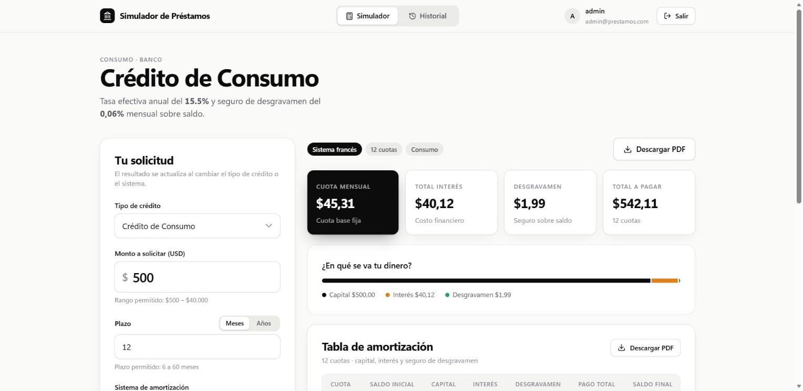
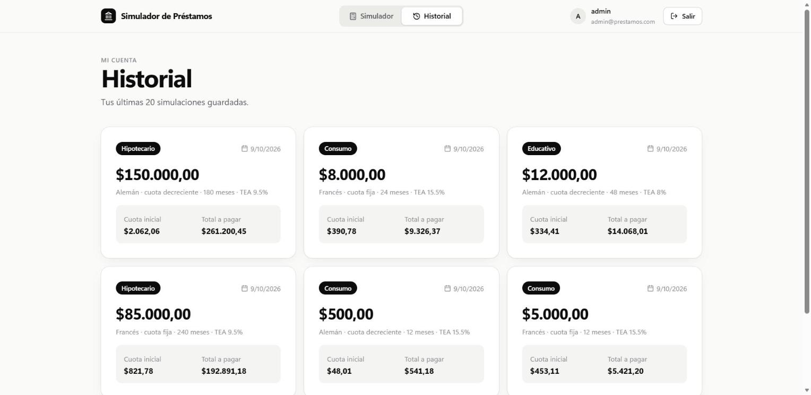
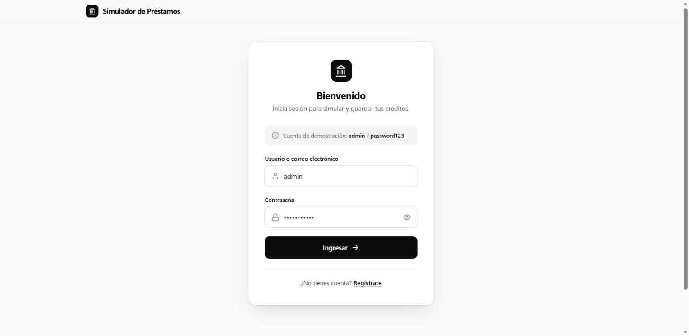
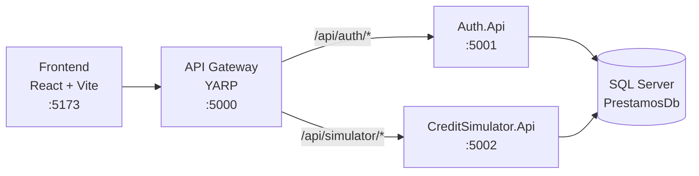

# Simulador de Préstamos


Aplicación web para **simular créditos bancarios** (consumo, hipotecario y educativo) con **sistema francés** (cuota fija) o **alemán** (cuota decreciente). Calcula la tabla de amortización con interés y seguro de desgravamen, guarda el historial de cada usuario y permite descargar el resultado en PDF.

El backend está construido con **microservicios en .NET 8** detrás de un **API Gateway (YARP)**, y el frontend con **React + Vite**.

<p align="center">
  
</p>

<p align="center">
  
  
</p>

## Características

- Tres tipos de crédito con tasa, monto y plazo propios, validados en el servidor.
- Sistema **francés** y **alemán**, con tabla de amortización paginada (capital, interés, desgravamen, pago total y saldo).
- Resumen con cuota mensual, total de interés, total de desgravamen y total a pagar, más la distribución del pago.
- **Registro e inicio de sesión** con JWT y contraseñas cifradas con BCrypt.
- **Historial** de las últimas 20 simulaciones por usuario (solo se guarda al presionar *Calcular*).
- Exportación de la tabla de amortización a **PDF**.
- Si el backend no está disponible, el simulador calcula en local (sin guardar en el historial).
- Interfaz responsive, accesible (etiquetas, foco visible, `prefers-reduced-motion`) y con diseño cuidado.

## Arquitectura



| Servicio | Responsabilidad | Puerto |
| --- | --- | --- |
| `ApiGateway` | Punto único de entrada, enruta por prefijo y gestiona CORS | 5000 |
| `Auth.Api` | Registro, login, emisión de JWT y usuario actual | 5001 |
| `CreditSimulator.Api` | Catálogo de créditos, cálculo de amortización e historial | 5002 |
| `Shared.Common` | DTOs, enums y `ApiResponse<T>` compartidos | — |

## Tecnologías

**Backend:** .NET 8 · ASP.NET Core · Entity Framework Core 8 · SQL Server · YARP · JWT Bearer · BCrypt · Swagger  
**Frontend:** React 18 · Vite 5 · jsPDF + AutoTable · Lucide Icons  
**Infraestructura:** Docker y Docker Compose

## Estructura del proyecto

```
SimuladordePrestamos/
├── backend/
│   ├── ApiGateway/                  # Proxy inverso (YARP)
│   ├── BuildingBlocks/
│   │   └── Shared.Common/           # DTOs, enums y modelos compartidos
│   ├── Services/
│   │   ├── Auth.Service/Auth.Api/               # Autenticación y usuarios
│   │   └── CreditSimulator.Service/CreditSimulator.Api/   # Simulación e historial
│   ├── Dockerfile                   # Imagen genérica para los 3 servicios
│   └── .dockerignore
├── frontend/
│   ├── src/
│   │   ├── components/              # Navbar, tabla de amortización
│   │   ├── context/                 # AuthContext (sesión)
│   │   ├── pages/                   # Login, registro, simulador, historial
│   │   ├── services/api.js          # Cliente HTTP
│   │   └── utils/                   # Formato de moneda y generación de PDF
│   └── .env.example
├── docs/screenshots/                # Capturas del README
├── docker-compose.yml               # SQL Server + los 3 servicios
├── .env.example                     # Plantilla de variables (contraseña de SQL Server)
└── ProyectoAgiles.sln               # Solución de Visual Studio
```

## Requisitos

- [Docker Desktop](https://www.docker.com/products/docker-desktop/) (recomendado para el backend)
- [Node.js](https://nodejs.org/) 18 o superior
- Opcional, para ejecutar el backend sin Docker: [.NET SDK 8](https://dotnet.microsoft.com/download/dotnet/8.0) o Visual Studio 2022 con la carga de trabajo *ASP.NET y desarrollo web*

## Inicio rápido

### 1. Clonar el repositorio

```bash
git clone https://github.com/juANO2202/SimuladordePrestamos.git
cd SimuladordePrestamos
```

### 2. Levantar el backend con Docker (recomendado)

Crea el archivo `.env` a partir de la plantilla y define una contraseña para SQL Server (mínimo 8 caracteres con mayúscula, minúscula y número):

```bash
cp .env.example .env        # en PowerShell: Copy-Item .env.example .env
# edita .env y completa MSSQL_SA_PASSWORD
```

Luego:

```bash
docker compose up -d --build
```

Esto levanta SQL Server (con volumen persistente), `Auth.Api`, `CreditSimulator.Api` y el Gateway. Las migraciones crean la base `PrestamosDb`, sus tablas y el usuario de demostración automáticamente.

| URL | Descripción |
| --- | --- |
| `http://localhost:5000` | API Gateway |
| `http://localhost:5001/swagger` | Swagger de Auth |
| `http://localhost:5002/swagger` | Swagger del Simulador |
| `localhost,1433` | SQL Server (usuario `sa`, contraseña del `.env`) |

Comandos útiles:

```bash
docker compose logs -f       # ver logs
docker compose down          # detener (los datos se conservan)
docker compose down -v       # detener y borrar la base de datos
```

### 3. Levantar el frontend

```bash
cd frontend
npm install
npm run dev
```

Abre **http://localhost:5173**.

> **Usuario precargado para ingresar al simulador:** `admin` / `password123`. Se crea automáticamente al iniciar el backend. También puedes crear tu propia cuenta desde *Regístrate*.

## Ejecutar el backend desde Visual Studio

1. Abre `ProyectoAgiles.sln`.
2. Elige la base de datos:
   - **SQL Server Express local:** usa la cadena por defecto de los `appsettings.json` (`Server=localhost\SQLEXPRESS;Trusted_Connection=True`).
   - **Sin SQL Server:** pon `"UseInMemoryDatabase": true` en el `appsettings.json` de `Auth.Api` y de `CreditSimulator.Api` (los datos se pierden al reiniciar).
3. Clic derecho en la solución → **Configurar proyectos de inicio** → **Varios proyectos**, y marca **Iniciar** en `Auth.Api`, `CreditSimulator.Api` y `ApiGateway`.
4. Presiona **F5** o **Ctrl+F5**. Inicia `Auth.Api` primero, porque crea la base de datos.

Los servicios no abren el navegador automáticamente; Swagger está en `/swagger` de cada servicio.

## API

Todas las rutas pasan por el Gateway (`http://localhost:5000`). Las respuestas usan el formato `{ success, message, data, errors }`.

| Método | Ruta | Auth | Descripción |
| --- | --- | :---: | --- |
| `POST` | `/api/auth/register` | — | Crea una cuenta y devuelve el token |
| `POST` | `/api/auth/login` | — | Inicia sesión y devuelve el token |
| `GET` | `/api/auth/me` | Sí | Datos del usuario autenticado |
| `GET` | `/api/simulator/credit-types` | — | Catálogo de créditos con tasas y límites |
| `POST` | `/api/simulator/calculate` | Opcional | Calcula la simulación; con `"save": true` y sesión iniciada la guarda en el historial |
| `GET` | `/api/simulator/history` | Sí | Últimas 20 simulaciones del usuario |

Ejemplo:

```bash
curl -X POST http://localhost:5000/api/simulator/calculate \
  -H "Content-Type: application/json" \
  -d '{"creditType":1,"amount":5000,"termMonths":12,"method":1}'
```

`creditType`: `1` Consumo · `2` Hipotecario · `3` Educativo. `method`: `1` Francés · `2` Alemán.

## Reglas de negocio

| Crédito | Tasa efectiva anual | Plazo | Monto |
| --- | --- | --- | --- |
| Consumo | 15,5 % | 6 a 60 meses | $500 a $40.000 |
| Hipotecario | 9,5 % | 12 a 300 meses | $10.000 a $500.000 |
| Educativo | 8,0 % | 6 a 120 meses | $1.000 a $80.000 |

- **Tasa mensual:** `(1 + TEA)^(1/12) − 1`.
- **Seguro de desgravamen:** 0,06 % mensual sobre el saldo pendiente.
- **Francés:** cuota fija `P · i · (1+i)^n / ((1+i)^n − 1)`; el capital crece y el interés baja cada mes.
- **Alemán:** capital constante `P / n`; la cuota total decrece.
- La última cuota ajusta el redondeo para que el saldo final sea exactamente 0.

## Configuración

| Variable / archivo | Dónde | Descripción |
| --- | --- | --- |
| `MSSQL_SA_PASSWORD` | `.env` (raíz) | Contraseña de `sa` para el contenedor de SQL Server |
| `VITE_API_URL` | `frontend/.env` | URL base del Gateway; por defecto `http://localhost:5000/api` |
| `UseInMemoryDatabase` | `appsettings.json` | `true` para usar una base en memoria |
| `JwtSettings` | `appsettings.json` | Clave, emisor, audiencia y expiración del token |

## Solución de problemas

**El backend no arranca en Visual Studio: "Una directiva de Control de aplicaciones bloqueó este archivo" (`0x800711C7`).**  
Es el *Control inteligente de aplicaciones* de Windows 11, que bloquea binarios recién compilados sin firma. Opciones: ejecutar el backend con Docker (sección anterior) o desactivarlo en *Seguridad de Windows → Control de aplicaciones y navegador → Configuración del Control inteligente de aplicaciones*. Desactivarlo no se puede revertir sin restablecer Windows.

**El front muestra "No se pudo establecer conexión con los servicios backend".**  
Verifica que el Gateway responda en `http://localhost:5000` (`docker compose ps`).

**Puerto ocupado (5000, 5001, 5002 o 1433).**  
Detén el proceso que lo usa o cambia el mapeo de puertos en `docker-compose.yml`.

**Quiero empezar con la base de datos limpia.**  
`docker compose down -v` y luego `docker compose up -d`.

## Seguridad

El usuario precargado `admin / password123` está pensado para que cualquiera pueda probar el simulador, por eso sus credenciales se muestran en la pantalla de login. Si algún día lo usas con datos reales:

- Cambia la clave `JwtSettings:Secret` y guárdala fuera del repositorio (variables de entorno o gestor de secretos).
- Cambia la contraseña del usuario `admin` y quita el aviso de la pantalla de login.
- Restringe CORS a tu dominio (hoy permite cualquier origen).
- Usa un usuario de base de datos con permisos mínimos en lugar de `sa` y no expongas el puerto 1433.
- Sirve la aplicación por HTTPS.

## Licencia

Distribuido bajo la licencia [MIT](LICENSE). Puedes usar, modificar y compartir el código manteniendo el aviso de copyright.

## Autor

**Juan Carlos Pashma Alvarez** — [@juANO2202](https://github.com/juANO2202)
